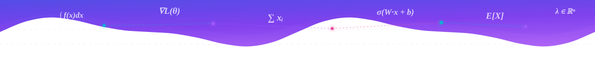
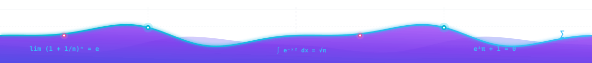

  

  <h1>
    Hi , I'm Saleh
  </h1>

  

  

    
    
  

  

    
  

---

###  About Me

  <picture>
    <source media="(prefers-color-scheme: dark)" srcset="./assets/about-card-dark.svg">
    <source media="(prefers-color-scheme: light)" srcset="./assets/about-card-light.svg">
    
  </picture>

| Dimension | Focus & Key Highlights |
| :--- | :--- |
|  **Academic Foundation** | **Master of Science (M.Sc.) in Mathematics** — Advanced analytical problem solving, probability, and linear algebra |
|  **Cloud Machine Learning** | **Google Cloud BigQuery ML** — Developing, training, and deploying scalable predictive models on cloud data platforms |
|  **Mathematical Rigor** | Mathematical modeling, statistical inference, calculus, and optimization for deep predictive data insights |
|  **Core Data Stack** | Advanced SQL, Python (NumPy, Pandas, Scikit-Learn), and high-performance data querying |
|  **Collaborations** | Open to high-impact initiatives in **Machine Learning**, **Data Science**, and **Applied Mathematics** |

---

###  Tech Stack

####  Mathematics & Data Science

  
  
  
  
  
  
  
  

####  Cloud & BigQuery ML

  
  

####  Databases & Querying

  
  
  

####  Tools & Environments

  
  
  

---

###  Featured Projects

| Project | Description | Tech Stack | Link |
| :--- | :--- | :--- | :--- |
| **[asac-sql-portfolio](https://github.com/salehmk/asac-sql-portfolio)** | Advanced SQL queries, schema design, aggregations, and business data analysis. | `SQL` `PostgreSQL` `RDBMS` | [View Repo](https://github.com/salehmk/asac-sql-portfolio) |
| **[Sunnah-Data](https://github.com/salehmk/Sunnah-Data)** | Data collection, text processing, and analysis using interactive computational notebooks. | `Python` `Jupyter` `NLP` | [View Repo](https://github.com/salehmk/Sunnah-Data) |
| **[football-logos](https://github.com/salehmk/football-logos)** | Image and data exploration project analyzing sports club branding and classification. | `Python` `Jupyter` `Data Science` | [View Repo](https://github.com/salehmk/football-logos) |
| **[ZipCompressor](https://github.com/salehmk/ZipCompressor)** | Python automation script to compress files and directories individually with clean archiving. | `Python` `Automation` `Utility` | [View Repo](https://github.com/salehmk/ZipCompressor) |

---

###  GitHub Stats & Activity

  <!-- Snake Animation eating GitHub Contributions -->
  <picture>
    <source media="(prefers-color-scheme: dark)" srcset="https://raw.githubusercontent.com/salehmk/salehmk/output/github-contribution-grid-snake-dark.svg" />
    <source media="(prefers-color-scheme: light)" srcset="https://raw.githubusercontent.com/salehmk/salehmk/output/github-contribution-grid-snake.svg" />
    
  </picture>

 

  <a href="https://github.com/salehmk">
    <picture>
      <source media="(prefers-color-scheme: dark)" srcset="https://github-readme-stats.vercel.app/api?username=salehmk&show_icons=true&include_all_commits=true&hide_border=true&bg_color=0D1117&title_color=FF2A55&icon_color=FF2A55&text_color=FFFFFF" />
      <source media="(prefers-color-scheme: light)" srcset="https://github-readme-stats.vercel.app/api?username=salehmk&show_icons=true&include_all_commits=true&hide_border=false&border_color=D0D7DE&bg_color=FFFFFF&title_color=BE123C&icon_color=DC2626&text_color=0F172A" />
      
    </picture>
  </a>
  <a href="https://github.com/salehmk">
    <picture>
      <source media="(prefers-color-scheme: dark)" srcset="https://github-readme-stats.vercel.app/api/top-langs/?username=salehmk&layout=donut&hide_border=true&bg_color=0D1117&title_color=FF2A55&text_color=FFFFFF" />
      <source media="(prefers-color-scheme: light)" srcset="https://github-readme-stats.vercel.app/api/top-langs/?username=salehmk&layout=donut&hide_border=false&border_color=D0D7DE&bg_color=FFFFFF&title_color=BE123C&text_color=0F172A" />
      
    </picture>
  </a>

 

  <a href="https://github.com/salehmk">
    <picture>
      <source media="(prefers-color-scheme: dark)" srcset="https://streak-stats.demolab.com/?user=salehmk&hide_border=true&background=0D1117&ring=FF2A55&fire=FF2A55&currStreakNum=FFFFFF&sideNums=FFFFFF&currStreakLabel=FF2A55&sideLabels=FF2A55&dates=FFFFFF&stroke=30363D" />
      <source media="(prefers-color-scheme: light)" srcset="https://streak-stats.demolab.com/?user=salehmk&hide_border=false&border=D0D7DE&background=FFFFFF&ring=BE123C&fire=E11D48&currStreakNum=0F172A&sideNums=0F172A&currStreakLabel=BE123C&sideLabels=BE123C&dates=334155&stroke=E2E8F0" />
      
    </picture>
  </a>

---

###  Top Repositories

  <a href="https://github.com/salehmk/asac-sql-portfolio">
    <picture>
      <source media="(prefers-color-scheme: dark)" srcset="https://github-readme-stats.vercel.app/api/pin/?username=salehmk&repo=asac-sql-portfolio&hide_border=true&bg_color=0D1117&title_color=FF2A55&icon_color=FF2A55&text_color=FFFFFF&description_lines_count=2" />
      <source media="(prefers-color-scheme: light)" srcset="https://github-readme-stats.vercel.app/api/pin/?username=salehmk&repo=asac-sql-portfolio&hide_border=false&border_color=D0D7DE&bg_color=FFFFFF&title_color=BE123C&icon_color=DC2626&text_color=0F172A&description_lines_count=2" />
      
    </picture>
  </a>
  <a href="https://github.com/salehmk/Sunnah-Data">
    <picture>
      <source media="(prefers-color-scheme: dark)" srcset="https://github-readme-stats.vercel.app/api/pin/?username=salehmk&repo=Sunnah-Data&hide_border=true&bg_color=0D1117&title_color=FF2A55&icon_color=FF2A55&text_color=FFFFFF&description_lines_count=2" />
      <source media="(prefers-color-scheme: light)" srcset="https://github-readme-stats.vercel.app/api/pin/?username=salehmk&repo=Sunnah-Data&hide_border=false&border_color=D0D7DE&bg_color=FFFFFF&title_color=BE123C&icon_color=DC2626&text_color=0F172A&description_lines_count=2" />
      
    </picture>
  </a>

  <a href="https://github.com/salehmk/football-logos">
    <picture>
      <source media="(prefers-color-scheme: dark)" srcset="https://github-readme-stats.vercel.app/api/pin/?username=salehmk&repo=football-logos&hide_border=true&bg_color=0D1117&title_color=FF2A55&icon_color=FF2A55&text_color=FFFFFF&description_lines_count=2" />
      <source media="(prefers-color-scheme: light)" srcset="https://github-readme-stats.vercel.app/api/pin/?username=salehmk&repo=football-logos&hide_border=false&border_color=D0D7DE&bg_color=FFFFFF&title_color=BE123C&icon_color=DC2626&text_color=0F172A&description_lines_count=2" />
      
    </picture>
  </a>
  <a href="https://github.com/salehmk/ZipCompressor">
    <picture>
      <source media="(prefers-color-scheme: dark)" srcset="https://github-readme-stats.vercel.app/api/pin/?username=salehmk&repo=ZipCompressor&hide_border=true&bg_color=0D1117&title_color=FF2A55&icon_color=FF2A55&text_color=FFFFFF&description_lines_count=2" />
      <source media="(prefers-color-scheme: light)" srcset="https://github-readme-stats.vercel.app/api/pin/?username=salehmk&repo=ZipCompressor&hide_border=false&border_color=D0D7DE&bg_color=FFFFFF&title_color=BE123C&icon_color=DC2626&text_color=0F172A&description_lines_count=2" />
      
    </picture>
  </a>

---

  

